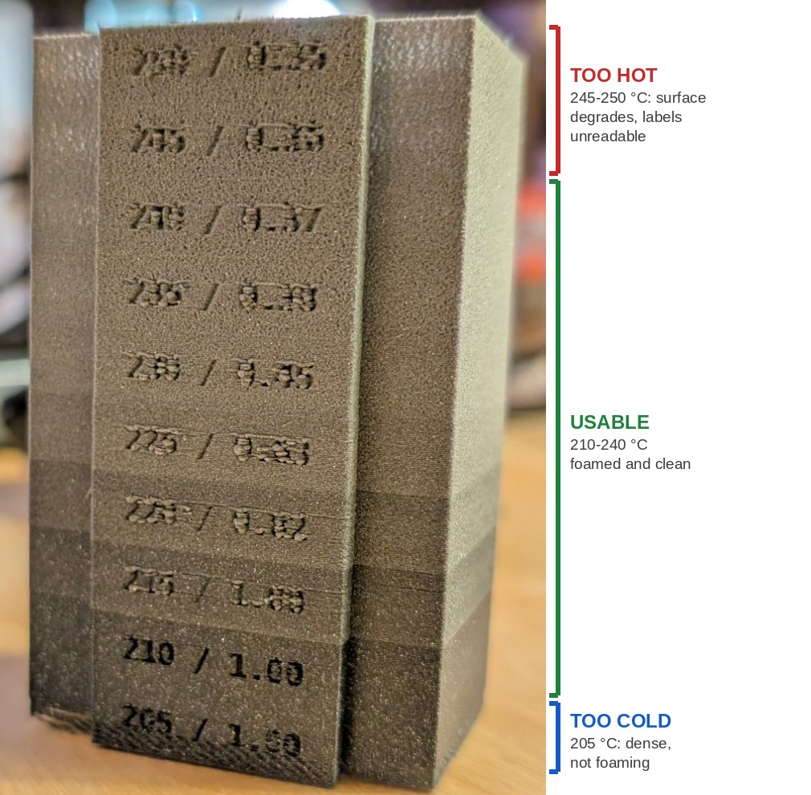
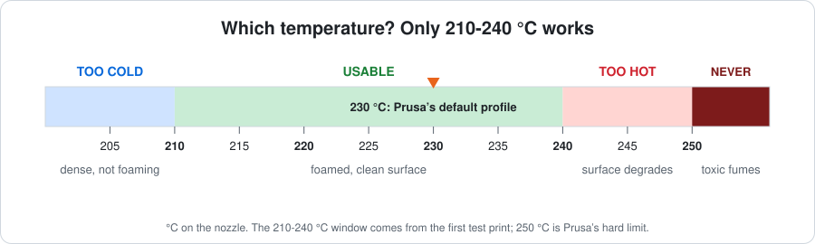
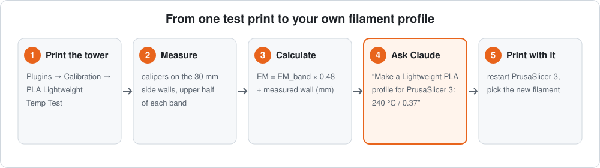
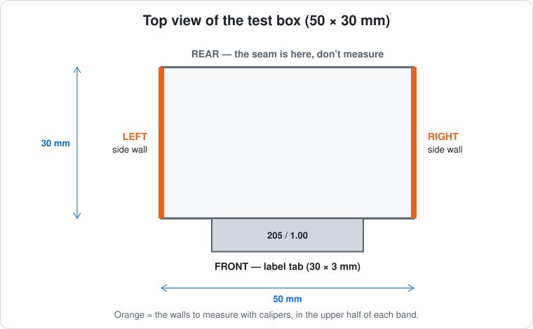
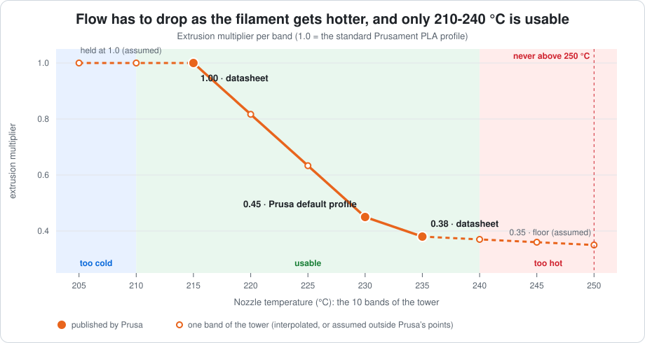
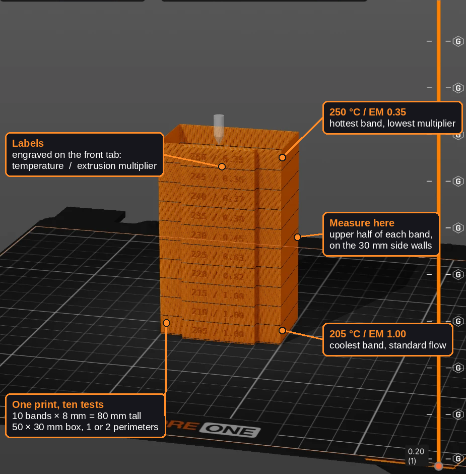

<div align="center">

# Prusament PLA Lightweight Test Tower

### Find the right temperature and flow for **Prusament PLA Lightweight** in PrusaSlicer 3, with one test print

[](https://www.prusa3d.com/product/prusament-pla-lightweight-galaxy-black-1kg-nfc/)
&nbsp;

&nbsp;
[](LICENSE)

**[What is this?](#what-is-this)** · **[Get the filament](#get-the-filament)** · **[Quick start](#quick-start-5-steps)** · **[Safety](#safety)** · **[Help](#help)**



*A real print of the tower on a Prusa CORE One. Each band was printed at a different temperature.*

</div>

> [!CAUTION]
> **For PrusaSlicer 3.0 only, and only while it is in alpha.** This project exists because the PrusaSlicer 3.0 alpha
> does **not** come with a Prusament PLA Lightweight profile by default. It is a stop-gap: a plugin that helps you find
> the right settings, and a generator that builds a profile from them.
>
> - **It needs PrusaSlicer 3.0.** Plugins are a PrusaSlicer 3 feature, so none of this works in PrusaSlicer 2.x.
> - **It was developed and tested on a 3.0 alpha** (alpha 14). The plugin system is experimental and can change between
>   releases, so this project may stop working at any time.
> - **Once Prusa ships an official Prusament PLA Lightweight profile for PrusaSlicer 3, use that instead.** Prusa's own
>   profile is the better choice. The same goes for any PrusaSlicer version that already includes one.
> - **This is a community project.** It is not made, endorsed or supported by Prusa Research. The settings come from
>   Prusa's published documentation plus our own test prints. Nothing is guaranteed: use it at your own risk and never
>   print above 250 °C.

---

## What is this?

**Prusament PLA Lightweight** is a *foaming* filament: it puffs up in the hot nozzle, so prints are up to 65 % lighter.
That also makes it fussy. **How much it puffs depends on the temperature, and the amount of plastic to push out has to
change with it.** Get it wrong and you get gaps, blobs or a rough surface.

This project gives you a **test tower** (a PrusaSlicer 3 plugin) that prints the filament at several temperatures in one go.
You look at it, measure it, and then **Claude can turn your result into a ready-made filament profile**.

<div align="center">

</div>

> [!NOTE]
> **The short answer from the first test print:** use **210 to 240 °C**. Below 210 °C the filament does not foam, and
> above 240 °C the surface falls apart. Prusa's own default profile is **230 °C**. The tower helps you find the exact
> temperature and flow for *your* printer and spool.

**You need:** a Prusa printer that Prusa lists for this filament (CORE One / One+, CORE One L, MK4S, XL), PrusaSlicer 3,
a spool of Prusament PLA Lightweight, and a pair of calipers. [Claude Code](https://claude.com/claude-code) is
optional but makes the last step automatic. *Tested so far on a CORE One with a 0.4 mm high-flow nozzle.*

## Get the filament

Prusament PLA Lightweight is made by Prusa. Buy it from the Prusa e-shop (prices and stock change, so look on the page):

| Colour | Prusa e-shop |
|---|---|
| Galaxy Black | [Prusament PLA Lightweight Galaxy Black 1 kg](https://www.prusa3d.com/product/prusament-pla-lightweight-galaxy-black-1kg-nfc/) |
| Natural | [Prusament PLA Lightweight Natural 1 kg](https://www.prusa3d.com/product/prusament-pla-lightweight-natural-1kg-nfc/) |
| Army Green | [Prusament PLA Lightweight Army Green 1 kg](https://www.prusa3d.com/product/prusament-pla-lightweight-army-green-1kg-nfc/) |
| Coral Orange | [Prusament PLA Lightweight Coral Orange 1 kg](https://www.prusa3d.com/product/prusament-pla-lightweight-coral-orange-1kg-nfc/) |
| Chocolate Brown | [Prusament PLA Lightweight Chocolate Brown 1 kg](https://www.prusa3d.com/product/prusament-pla-lightweight/) |

More from Prusa: [Prusa website](https://www.prusa3d.com/) · [Prusament](https://prusament.com/) ·
[PrusaSlicer](https://www.prusa3d.com/p/prusaslicer/) · [all filaments](https://www.prusa3d.com/category/filament/) ·
[Prusa's article about this filament](https://blog.prusa3d.com/prusament-pla-lw-65-lighter-than-regular-pla-perfect-choice-for-aircraft-cosplay-and-more_138059/) ·
[Knowledge Base: LW PLA](https://help.prusa3d.com/article/lw-pla_304914)

---

## Quick start: 5 steps

<div align="center">

</div>

### 1. Dry the filament
Prusament PLA Lightweight absorbs moisture. Dry it **5 hours at 55 °C** before printing (Prusa's advice).

### 2. Install the plugin
Download this repository (green **Code** button → *Download ZIP*) and copy the folder
**`com.community.pla-lw-temp-test`** into PrusaSlicer 3's `lua` folder, then restart PrusaSlicer 3.

| Your install | Put the folder in |
|---|---|
| Flatpak (Linux) | `~/.var/app/com.prusa3d.PrusaSlicer/config/PrusaSlicer3-dev/lua/` |
| Linux | `~/.config/PrusaSlicer3-dev/lua/` |
| macOS | `~/Library/Application Support/PrusaSlicer3-dev/lua/` |
| Windows | `%APPDATA%\PrusaSlicer3-dev\lua\` |

*Not sure where it is? Look for the folder that contains `PrusaSlicer.ini`. Copy the folder, don't link it.*

### 3. Print the tower
1. Select your printer and the standard **Prusament PLA** profile.
2. Click **Plugins → Calibration → PLA Lightweight Temp Test**, then **Run**. Keep the defaults for your first try.
3. Slice and print. It takes about an hour.

> [!IMPORTANT]
> The plugin changes your *active* settings for the test (temperatures, fan, speed, retraction). **Do not save the
> profile over Prusament PLA.** Save it under a new name, or discard the changes afterwards.

### 4. Measure the walls
Every band is a single thin wall, so the wall *is* the plastic line. With calipers, measure the two **30 mm side walls**
in the **upper half of each band**, and write the numbers down. The tab on the front says which band is which.

<div align="center">

</div>

You want about **0.45 to 0.50 mm**. Type your readings into the analyzer (`temperature=wall`). It tells you how much
plastic each temperature needs:

```bash
python3 tools/analyze_results.py 210=0.62 220=0.55 230=0.50 240=0.47 --pick 230
```

*No terminal? Tell Claude your readings and it runs this for you.*

### 5. Make your filament profile
Open this repository in [Claude Code](https://claude.com/claude-code) and ask, in plain language:

> *Look at this repo and make me a Lightweight PLA filament profile for PrusaSlicer 3 with the 230 °C / 0.43 combo.
> I have a Prusa CORE One with a 0.4 high-flow nozzle.*

Claude finds your printer's Prusament PLA profile, builds the new one, **checks it against the real slicer**, and
asks before installing it. Restart PrusaSlicer 3 and pick the new filament.

The new profile already handles temperature, flow, fan, retraction and speed (about **50 mm/s**). The one thing a
filament profile cannot hold is **"Avoid crossing perimeters"** (maximum detour 40 mm, Prusa's tip against stringing).
Turn it on in your print settings, and print one model at a time.

---

## Safety

> [!WARNING]
> **Never print above 250 °C.** Prusa says Prusament PLA Lightweight can give off dangerous fumes above that. The plugin
> and the tools refuse any temperature above 250 °C. Print in a ventilated room.

The plugin warns you in several places, because a plugin cannot show a pop-up:

| Where | What you see |
|---|---|
| The dialog | The Min and Max boxes state the limits |
| The printed tower | A band outside 210-240 °C is engraved `COLD` or `HOT` |
| The printer's display | `LW 3/7 220C EM0.82` for a normal band, `HOT 245C degrades` for a flagged one |
| Above 250 °C | **Refused.** Nothing is changed, and a plate saying `NO - ABOVE 250 C = TOXIC FUMES` appears |

Want to see the bad ends yourself? Tick **Wide test** (205 to 250 °C).

## Help

- Something looks wrong, or you have a photo of your own tower? [Open an issue](../../issues).
- **Status: early.** The plugin runs in PrusaSlicer 3 and the first tower has been printed. The profile generator is
  verified against the slicer but not yet test-printed. Details are below.

---

## For the curious

<details>
<summary><b>Why does the flow have to change with temperature?</b></summary>

<br>

The hotter the nozzle, the more the filament foams, and the fatter the extruded line gets. To keep the same wall width
you must push out *less* plastic at higher temperatures. The "extrusion multiplier" is that amount: 1.0 is standard PLA.
Prusa publishes 1.0 at 215 °C, 0.45 at 230 °C and 0.38 at 235 °C. Each band of the tower is printed with the multiplier
from this curve, so you can measure how far off it is for your printer.

<div align="center">

</div>

</details>

<details>
<summary><b>What the plugin changes for the test</b></summary>

<br>

Starting from the standard Prusament PLA profile, the plugin sets: first layer 215 °C, then a different temperature
(`M104`) and flow (`M221`) for each band, fan 30 % (100 % on bridges), no layer-time slowdown, 50 mm/s, bed 60 °C and
retraction off. The full table and a pre-print checklist are in the
[plugin README](com.community.pla-lw-temp-test/README.md).

<div align="center">
<br>
<em>The wide 205-250 °C test in the PrusaSlicer 3 preview (first version of the labels).</em>
</div>

</details>

<details>
<summary><b>What the generated profile changes (checked in real G-code)</b></summary>

<br>

We sliced the same test model with stock Prusament PLA and with a generated profile (CORE One, 0.4 HF nozzle) and
compared the G-code the printer would receive:

| Setting | Stock Prusament PLA | Generated profile |
|---|---|---|
| Retractions | 405 retractions of 0.7 mm | **0** |
| Fan | 85-100 % (plus dynamic overhang fans) | **30 %**, 100 % on bridges, ramping up over the first layers |
| Print speed | perimeters 150 mm/s, outer 200 mm/s | **about 50 mm/s** (bridges slower) |
| Extrusion multiplier | 1.0 | **your value** (0.43 in this run) |
| Temperature | 230 °C | **your value** |
| Layer-time slowdown | on | off |
| CORE One heatbreak command (`M142 S36`) | yes | **kept** |
| Pressure advance (`M572 S0.036`) | yes | kept (see below) |

The **printer profile needs no change**: the filament profile overrides retraction, so the printer's own retraction
setting is never used. Speed is controlled with the filament's *maximum volumetric speed* (how much plastic per second
may be pushed through the nozzle), the right control for a foaming filament because foaming depends on how long the
plastic sits in the hot end. It matches the tower, which was printed at about 50 mm/s.

**Pressure advance** is left at your printer's stock value. Foaming filament is compressible, so some people lower it. To
try that: `--pressure-advance 0.01` (verified to reach the G-code).

**Still manual:** "Avoid crossing perimeters" (a print setting) and drying the filament.

Reproduce the comparison with `python3 tools/check_gcode.py` (see `CLAUDE.md`).

</details>

<details>
<summary><b>The numbers, step by step (for experts)</b></summary>

<br>

`EM_needed = EM_band × target wall / measured wall`, with a target of 0.48 mm for 1 perimeter (about 0.9 mm for 2).
Example: the 215 °C band (EM 1.00) measures 0.55 mm, so 1.00 × 0.48 / 0.55 ≈ **0.87**.
The palest, lightest band is the most foamed, hotter bands string more and are weaker, and above 235 °C there is little
extra weight saving. Pick the temperature by looking at the print as well as the numbers.

The generated filament preset inherits from *Prusament PLA* and sets temperature, first-layer temperature, extrusion
multiplier, bed 60 °C, constant 30 % fan, no slowdown and retraction off. It also copies back the printer-specific
values of the stock profile (for example the CORE One heatbreak G-code and the high-flow volumetric limit), which a plain
"inherit from Prusament PLA" silently loses.

Run the tools yourself (Python 3.8+, no dependencies):

```bash
python3 tools/resolve_stock.py --list-printers
python3 tools/resolve_stock.py --list-materials "Prusa CORE One & One+ 0.4 HF"
python3 tools/resolve_stock.py --printer "Prusa CORE One & One+ 0.4 HF" \
    --print "0.20mm BALANCED @COREONE 0.4HF" \
    --material "Prusament PLA @COREONE HF0.4@COREONE 0.4" --out stock.json
python3 tools/make_profile.py --temp 230 --em 0.43 --printers COREONE --nozzle 0.4 --high-flow \
    --stock-json stock.json --out profiles          # add --install to copy it into PrusaSlicer
```

</details>

<details>
<summary><b>What is verified, and what isn't</b></summary>

<br>

| | Status |
|---|---|
| Plugin builds the tower in PrusaSlicer 3 alpha | ✅ |
| Tower printed: 205 °C too cold, 210-240 °C usable, 245-250 °C too hot | ✅ first print, one printer, one spool |
| Plugin maths, G-code order and formatting | ✅ mock-API tests (`luajit tests/plugin_test.lua`) |
| Generated preset loads and resolves correctly in the slicer | ✅ checked with the slicer CLI |
| Generated preset in real sliced G-code: retractions 405 → 0, fan 30 %, speed about 50 mm/s | ✅ `tools/check_gcode.py` |
| Larger labels, band grooves, COLD/HOT tags, refusal plate, `M117` messages | ⏳ added after the first print, not yet seen in the slicer |
| Walls measured and a generated profile test-printed | ⏳ in progress |
| Fan, retraction and first-layer settings written by the plugin | ⚠️ the plugin API silently ignores some setting types, so the plugin reads them back; see the checklist in the plugin README |
| Flow between Prusa's published points, and at 205 °C and 250 °C | ⚠️ interpolated or assumed, which is why you measure |

</details>

<details>
<summary><b>Glossary</b></summary>

<br>

- **Foaming:** the filament expands in the hot nozzle, so the print is full of tiny air bubbles and weighs less.
- **Extrusion multiplier (EM):** how much plastic the printer pushes out. 1.0 is normal; this filament needs 0.35 to 1.0.
- **Band:** one temperature section of the tower.
- **Perimeter:** one line of plastic around the edge of a layer. The test uses a single one, so the wall *is* one line.
- **Profile (preset):** a saved set of settings in PrusaSlicer.

</details>

<details>
<summary><b>Tests and repository layout</b></summary>

<br>

```bash
luajit tests/plugin_test.lua          # plugin logic against a mock of the slicer API
python3 -I tests/profile_test.py      # preset generator (PyYAML optional, used for stricter checks)
python3 -I tests/resolve_test.py      # helper functions
python3 -I tests/analyze_test.py      # results analyzer and shared limits
python3 -I tests/gcode_test.py        # G-code comparison parser
python3 tools/make_diagrams.py        # regenerate docs/images/*.svg from the plugin's numbers
```

| Path | What |
|---|---|
| `com.community.pla-lw-temp-test/` | the plugin ([README](com.community.pla-lw-temp-test/README.md)) |
| `tools/` | analyzer, profile generator, slicer helper, G-code check, diagram generator |
| `CLAUDE.md` | step-by-step instructions Claude follows to make and verify a profile |
| `docs/REFERENCES.md` | every Prusa link and what it was used for |

</details>

---

## Sources

All Prusa documentation is linked, with what each page was used for, in **[docs/REFERENCES.md](docs/REFERENCES.md)**.
The main ones: [Prusa's article](https://blog.prusa3d.com/prusament-pla-lw-65-lighter-than-regular-pla-perfect-choice-for-aircraft-cosplay-and-more_138059/),
[Knowledge Base: LW PLA](https://help.prusa3d.com/article/lw-pla_304914), the Prusament PLA Lightweight Technical
Datasheet v1.0 (Prusa Polymers), the [PrusaSlicer Plugin API](https://github.com/prusa3d/PrusaSlicer/blob/master/doc/Plugin_API.md)
and the [Buddy firmware G-codes](https://help.prusa3d.com/article/buddy-firmware-specific-g-code-commands_633112).

*This is a community project and is **not affiliated with Prusa Research**. Prusa, Prusament and PrusaSlicer are Prusa
Research trademarks. Licensed under AGPL-3.0, see [LICENSE](LICENSE).*
